<picture>
  <source media="(prefers-color-scheme: dark)" srcset="assets/hero-dark.svg">
  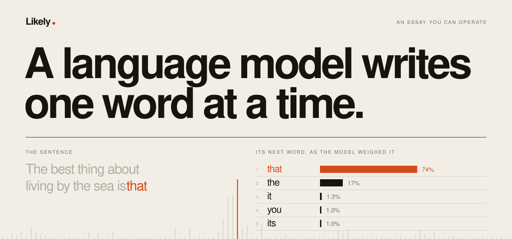
</picture>

<p align="center">
  <a href="https://pratyushshivam.github.io/likely/"><b>Open it</b></a> ·
  <a href="#how-a-word-is-chosen">How a word is chosen</a> ·
  <a href="#the-model">The model</a> ·
  <a href="#measured">Measured</a> ·
  <a href="#run-it">Run it</a> ·
  <a href="https://www.pratyushshivam.com/">pratyushshivam.com</a>
</p>

# Likely

**Watch a language model choose its next word.** One page, three things to do, and a real model running in your browser.

A language model writes one word at a time, and every word is a draw from a list of odds. This page shows you the list, lets you bend the odds, and lets you follow the sentences that were never written. Nothing is mocked: the odds on screen are the model's own.

**Open:** [pratyushshivam.github.io/likely](https://pratyushshivam.github.io/likely/)

<a href="https://pratyushshivam.github.io/likely/">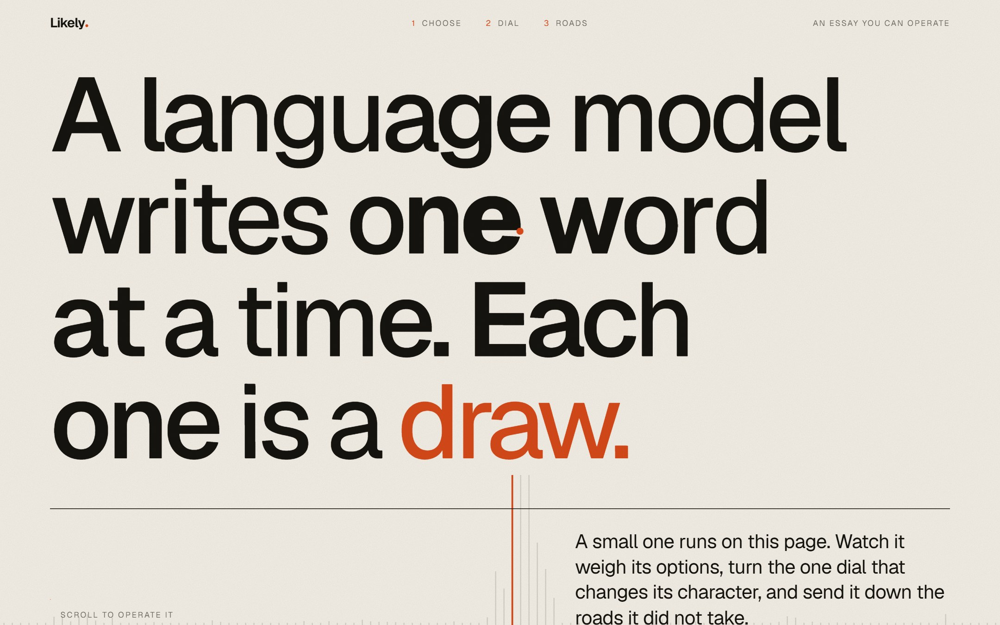</a>

## Three things to do

### 1. Watch it choose

Type the start of a sentence. Before every word the page shows the front-runners and the odds the model gives them. One is drawn, the row lights up, and the word drops into the line.

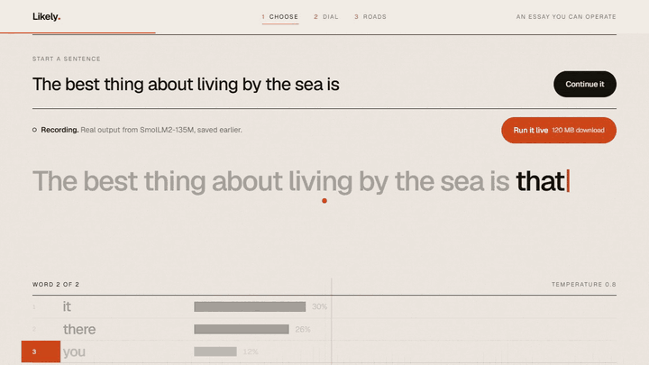

### 2. Turn the dial

One control: temperature. Turn it down and the favourite swells until nothing else can win. Turn it up and the list flattens until long shots get through. The sentence is rewritten as you drag.

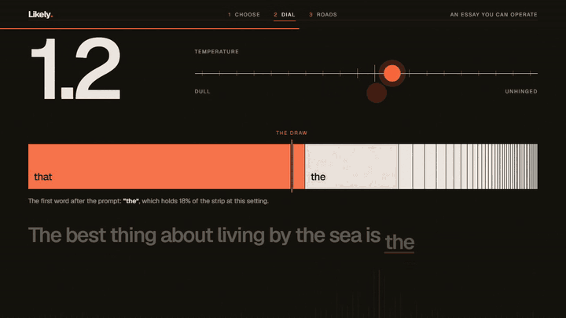

### 3. Take the other road

Click any word, then pick what it could have been instead. The model carries on from there. The branches grow into a small tree, and the whole tree is stored in the link, so whoever opens it sees exactly what you saw.

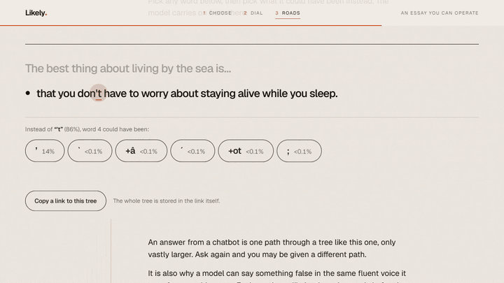

<table>
<tr>
<td width="50%" valign="top">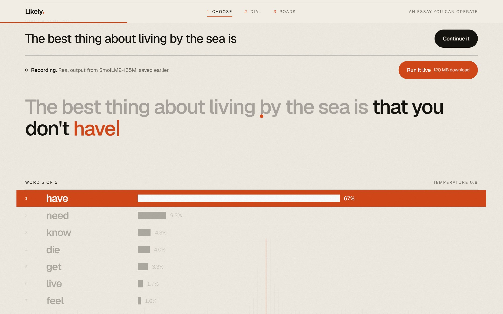<br><sub><b>The pick.</b> The chosen row, a moment before the word lands.</sub></td>
<td width="50%" valign="top">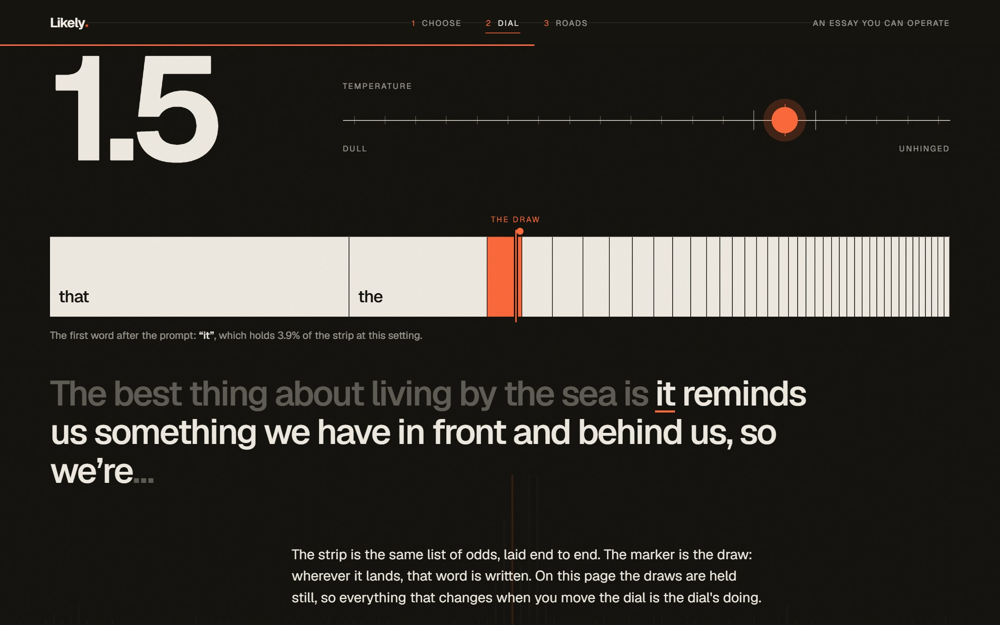<br><sub><b>The dial at 1.5.</b> The odds flatten and the writing wanders.</sub></td>
</tr>
<tr>
<td width="50%" valign="top">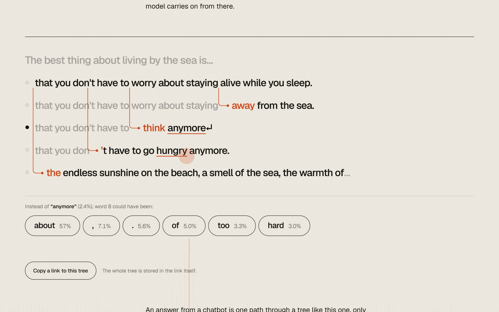<br><sub><b>The roads.</b> Five sentences from one beginning.</sub></td>
<td width="50%" valign="top">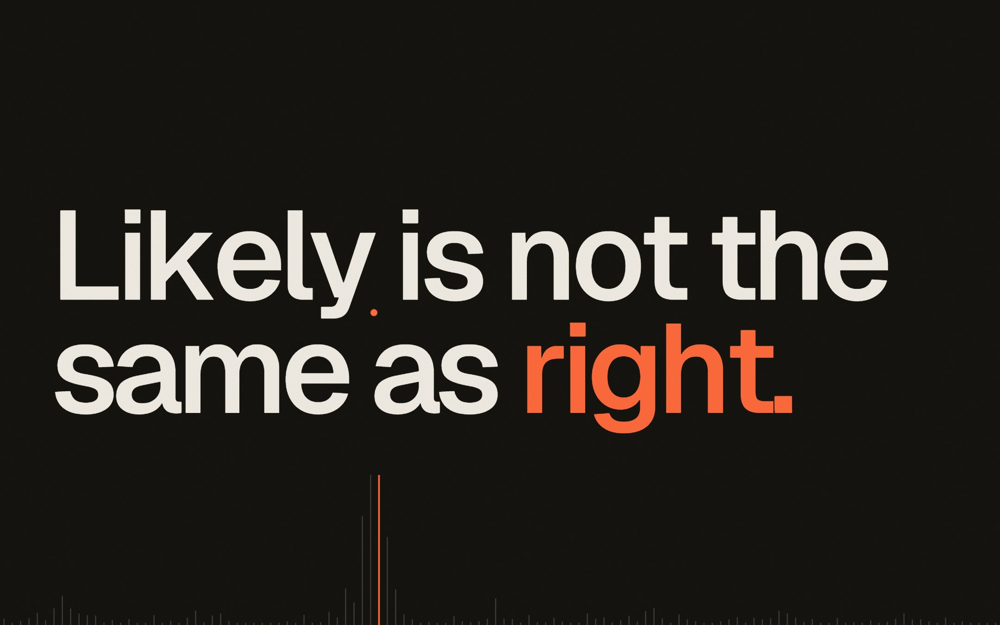<br><sub><b>The point.</b> Each word was likely. That is all it was.</sub></td>
</tr>
</table>

<table>
<tr>
<td width="25%" valign="top">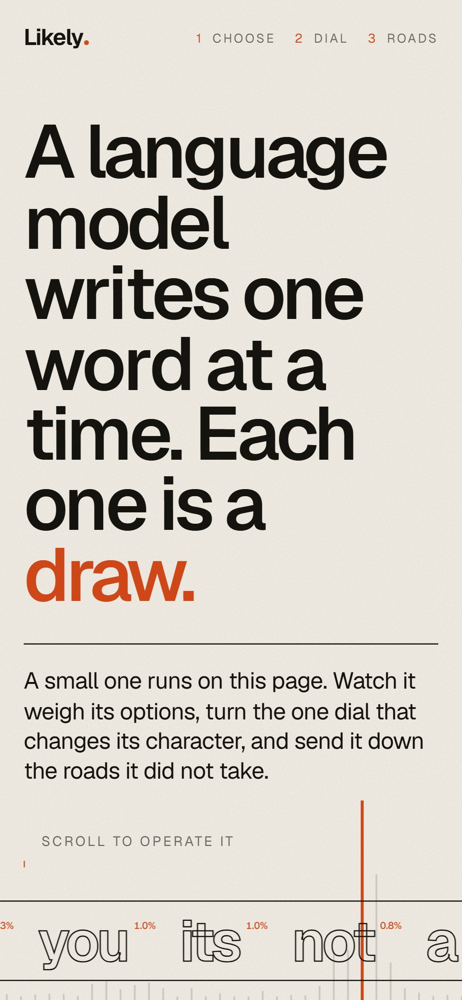</td>
<td width="25%" valign="top">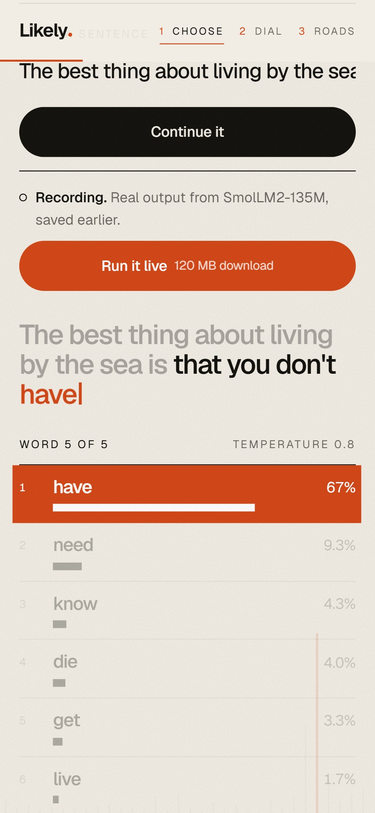</td>
<td width="25%" valign="top">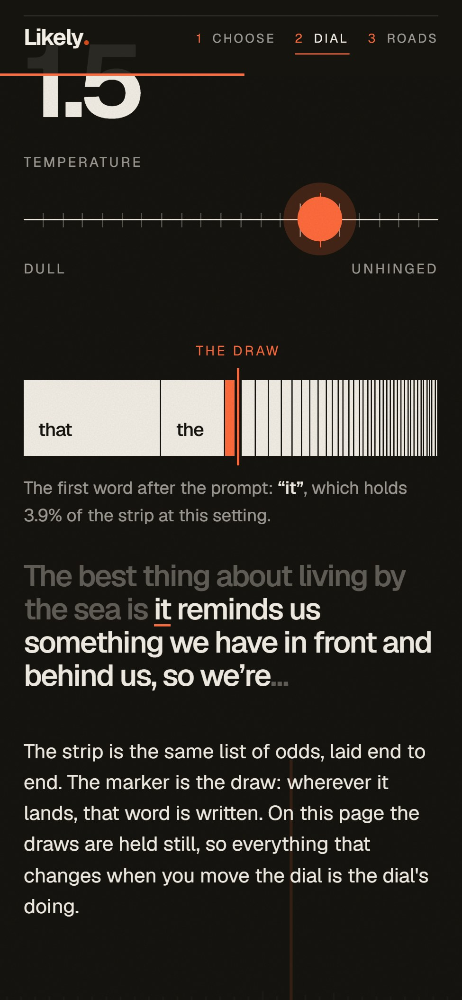</td>
<td width="25%" valign="top">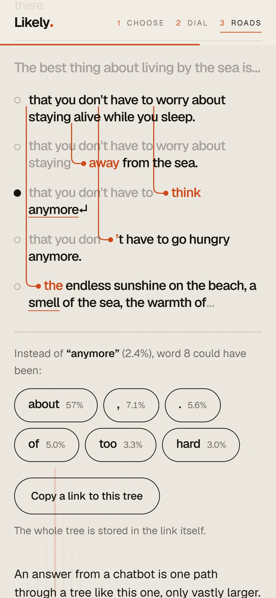</td>
</tr>
</table>

<p align="center"><sub>The same page on a phone. It also works with a keyboard alone, and it holds still if you ask for reduced motion.</sub></p>

| | |
| :-- | :-- |
| **What runs** | SmolLM2-135M, a 135 million parameter language model, in your browser. No server, no API key, no analytics |
| **First visit** | Opens at once on a recording of the model's real output: 0.26 MB |
| **Live** | One press downloads the model (120 MB on WebGPU, 140 MB on WebAssembly). Your browser keeps it; later visits start in about two seconds |
| **Privacy** | Nothing you type leaves your device |
| **Stack** | TypeScript and Vite, no framework. Transformers.js on ONNX Runtime Web in a worker. GSAP and Lenis for motion |

## How a word is chosen

<picture>
  <source media="(prefers-color-scheme: dark)" srcset="assets/dial-dark.svg">
  
</picture>

1. **Score.** The model reads everything written so far and returns one number, a logit, for each of the 49,152 tokens in its vocabulary. A token is usually a word, sometimes a fragment or a full stop.
2. **Shortlist.** The page keeps the 40 highest (top-k sampling).
3. **Weigh.** The scores become probabilities: `p = softmax(score / temperature)`. A low temperature exaggerates the gaps between scores. A high one shrinks them.
4. **Draw.** The probabilities are laid end to end from 0 to 1, and a number between 0 and 1 picks the word whose stretch it lands in.
5. **Repeat** with the longer text, until a full stop, a line break, or 16 tokens.

The draws are fixed by a seed, on purpose. With the draws held still, anything that changes when you move the dial is the dial's doing. The diagram above is drawn from the recording by `npm run readme`; the three sentences in it are what the model wrote.

| Part | What it does | Where |
| :-- | :-- | :-- |
| **Sampling** | Temperature, probabilities, the draw, top-k | [`sampling.ts`](src/core/sampling.ts) |
| **Writing** | Continues a sentence from any source of candidates, live or recorded | [`generate.ts`](src/core/generate.ts) |
| **The tree** | Sentences that share a beginning share nodes. Rewriting one leaves the others alone | [`tree.ts`](src/core/tree.ts) |
| **Links** | The prompt, the dial and the whole tree, in the URL fragment | [`share.ts`](src/core/share.ts) |
| **The recording** | The saved model output and how it is looked up | [`recording.ts`](src/core/recording.ts) |
| **The model** | One question to the model: what could come next, and with what scores? | [`lm.ts`](src/model/lm.ts) |

Everything in [`src/core`](src/core) is plain TypeScript with no DOM, covered by 38 unit tests. The same code makes the recording, runs the page and draws the diagram.

**What is real and what is not.** The scores, the probabilities and the sentences are the model's. The recording is real output, replayed. The only liberties are the ones named above: the shortlist of 40, the fixed draws, and the rule for where a sentence ends. A link is untrusted input: it is validated, size-limited, and only ever written to the page as text.

**What the recording covers.** The sentence at all 20 stops of the dial, and at the default setting the road from each of the top seven runner-ups at every word. Anything else, including your own sentence, needs the live model, and the page says so when you get there.

## The model

| | |
| :-- | :-- |
| **Model** | [SmolLM2-135M](https://huggingface.co/HuggingFaceTB/SmolLM2-135M) by Hugging Face |
| **Licence** | Apache 2.0 |
| **Weights** | [onnx-community/SmolLM2-135M-ONNX](https://huggingface.co/onnx-community/SmolLM2-135M-ONNX), fetched from the Hugging Face hub when you go live |
| **On WebGPU** | 4-bit weights with 16-bit activations (`q4f16`) |
| **On WebAssembly** | 8-bit weights (`q8`). The recording was made with these |
| **Runtime** | [Transformers.js](https://github.com/huggingface/transformers.js) 4.3 on ONNX Runtime Web |

It is the smallest model I tried that writes sensible English about whatever you type. Two smaller ones were tested on the same prompts:

| Model | Download | Given "The capital of France is" |
| :-- | :-- | :-- |
| `Xenova/llama2.c-stories15M` | 15 MB | "very popular. Everyone wants to be around him." Fluent, but it only knows children's stories |
| `Xenova/distilgpt2` | 85 MB | "to be named the "Souvenir" of the French capital of France." |
| **SmolLM2-135M** | 120 to 140 MB | "situated on the left bank of the Seine" |

To try another model, change [`src/model/config.ts`](src/model/config.ts) and run `npm run record`.

## Measured

On the production build, in Chrome, November 2026.

| What | Size |
| :-- | :-- |
| The page without the model: HTML, CSS, script, typeface and recording, compressed | 0.26 MB |
| The same, uncompressed | 0.55 MB |
| The recording alone | 253 KB (103 KB compressed) |
| Live model on WebGPU: weights, graph and tokenizer | 120 MB |
| Live model on WebAssembly | 140 MB |
| ONNX Runtime's WebAssembly binary, fetched once from jsDelivr when you go live | 26.9 MB (about 7 MB compressed) |
| Return visit with the model in the browser's cache | about 2 s to start |

## Run it

Needs Node.js 20 or newer.

```bash
npm install
```

```bash
npm run dev
```

Then open `http://localhost:5190`.

| Command | What it does |
| :-- | :-- |
| `npm run dev` | Development server |
| `npm run build` | Typecheck, then a static build to `dist/` that works from any folder on any static host |
| `npm test` | Unit tests for the sampling, the tree, the links and the recording |
| `npm run record` | Runs the real model in Node and rewrites `public/recording.json` |
| `npm run readme` | Rebuilds the graphics on this page from the recording |

The screenshots and animations above are the production build, driven in Chrome on the recording.

## How it is put together

```
src/core     the logic: sampling, writing, the tree, links, the recording. Pure, tested.
src/model    the live model: a worker, its client, and the one-line choice of model
src/ui       motion (opening, scroll, cursor, the field of bars) and text helpers
src/main.ts  the page: the odds, the dial, the roads
scripts      makes the recording and the README graphics
```

The row of thin bars behind the page is a probability distribution too. The pointer moves its peak, and acts as its temperature: near the top of the screen the favourite takes everything, near the bottom the odds go flat.

## Licence

[MIT](LICENSE). SmolLM2 is by Hugging Face under Apache 2.0. Transformers.js is Apache 2.0, ONNX Runtime and Lenis are MIT, and GSAP is used under its standard no-charge licence. The Geist typeface is used under the SIL Open Font License.
