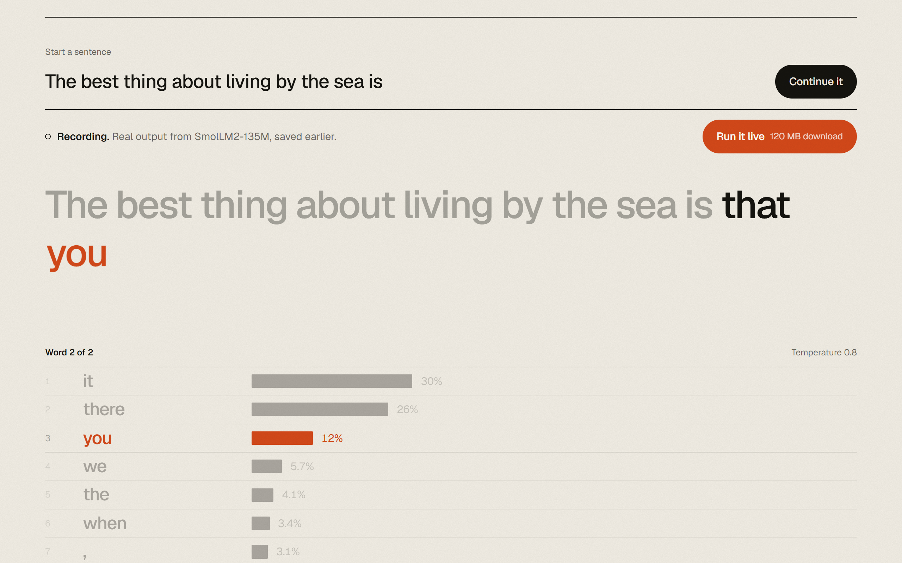
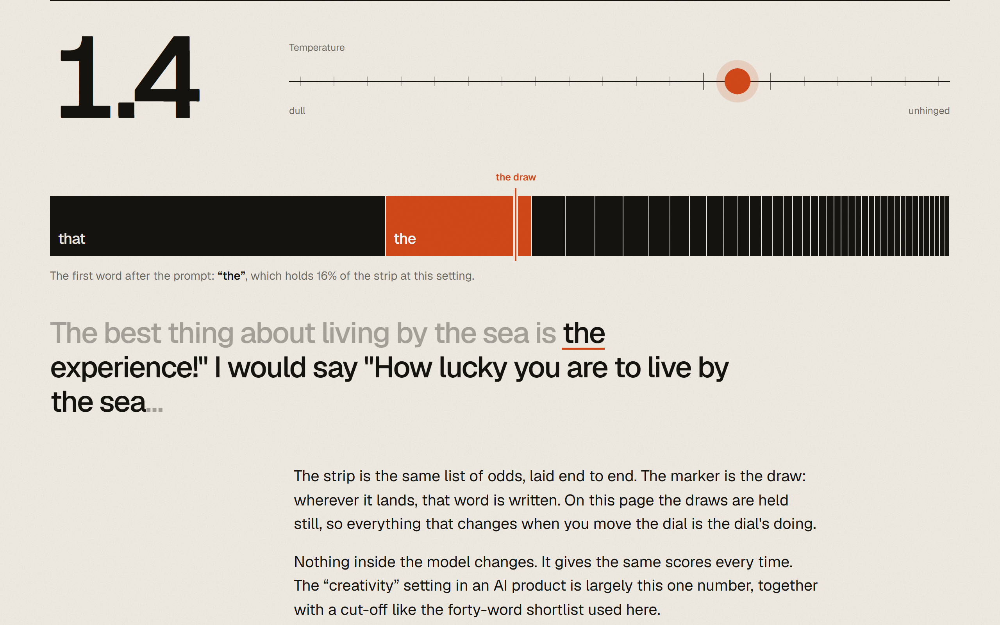
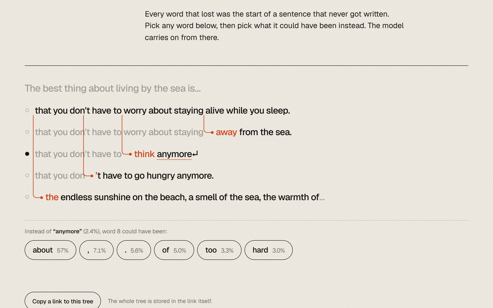

# Likely

**Watch a language model choose its next word.** One page, three things to do, a real model running in your browser.



A language model writes one word at a time, and every word is a draw from a list of odds. This page lets you see the list, change the odds, and follow the sentences that were not written.

1. **Watch it choose.** Type the start of a sentence. Before each word, the page shows the model's front-runners and their probabilities, then the chosen word drops into the line.
2. **Turn the dial.** One temperature control. The odds reshape as you move it and the sentence is rewritten: dull at one end, unhinged at the other.
3. **Take the other road.** Click any runner-up to branch the sentence from that point. The branches grow into a small tree, and the whole tree is stored in the URL, so a link shows someone else exactly what you saw.

| | |
| --- | --- |
|  |  |

## Run it

```bash
npm install
npm run dev
```

Then open http://localhost:5190. No server code, no API keys, no analytics. `npm run build` writes a static site to `dist/` that works from any folder on any static host.

```bash
npm test          # unit tests for the sampling, tree and link logic
npm run build     # typecheck, then build
npm run record    # re-make the recording from the real model (needs a network connection once)
```

## How it works

**The page opens without the model.** What plays first is a recording of real model output (`public/recording.json`): for every point the recorded runs pass through, the model's top 40 candidates and their scores. The recording covers the sentence at all 20 stops of the dial, and at the default setting the road from each of the top seven runner-ups at every word. Probabilities are recomputed from the recorded scores in your browser, so the dial is exact, not a set of pictures.

**"Run it live" downloads the model once.** The browser keeps it (Cache API), so a return visit starts in about two seconds. After that anything works: your own sentence, any branch, any setting. The model runs in a Web Worker so the page stays smooth, on WebGPU when the browser has it and on WebAssembly otherwise. Nothing you type leaves your device.

**How a word is chosen.** For each position the model returns a score (a logit) for all 49,152 tokens in its vocabulary. The page keeps the 40 highest (top-k), turns them into probabilities with `p = softmax(score / temperature)`, lays those probabilities end to end from 0 to 1, and picks the token whose stretch contains a fixed number for that position (inverse-CDF sampling). The numbers are fixed by a seed, on purpose: with the draws held still, anything that changes when you move the dial is the dial's doing. A sentence ends at a full stop, a line break, the end-of-text token, or 16 tokens.

**Links.** The URL fragment holds the prompt, the temperature and the tree (the text of every token, nested, base64url). Opening a link restores the same tree without the model. Everything read from a link is validated and size-limited, and is only ever written to the page as text.

## The model

| | |
| --- | --- |
| Model | [SmolLM2-135M](https://huggingface.co/HuggingFaceTB/SmolLM2-135M) by Hugging Face, 135 million parameters |
| Licence | Apache 2.0 |
| ONNX weights | [onnx-community/SmolLM2-135M-ONNX](https://huggingface.co/onnx-community/SmolLM2-135M-ONNX), fetched from the Hugging Face hub |
| On WebGPU | 4-bit weights, 16-bit activations (`q4f16`) |
| On WebAssembly | 8-bit weights (`q8`); the recording was made with these |
| Runtime | [Transformers.js](https://github.com/huggingface/transformers.js) 4.3 on ONNX Runtime Web |

Why this one: it is the smallest model I tried that writes sensible English about anything you type. Two smaller candidates were tested on the same prompts. `Xenova/llama2.c-stories15M` (15 MB) is fluent but only knows children's stories ("The capital of France is very popular. Everyone wants to be around him."). `Xenova/distilgpt2` (85 MB) loses the thread within a few words. To try another model, change `src/model/config.ts` and run `npm run record`.

## Measured sizes

Measured on the production build in Chrome, November 2026.

| What | Size |
| --- | --- |
| The page without the model (HTML, CSS, JS, font, recording), gzip over the wire | 0.19 MB |
| The same, uncompressed | 0.37 MB |
| Live model, WebGPU (weights, graph, tokenizer) | 120 MB |
| Live model, WebAssembly | 140 MB |
| ONNX Runtime's WebAssembly binary, fetched once from jsDelivr when you go live | 26.9 MB (about 7 MB compressed) |
| Return visit, model already in the browser's cache | about 2 s to start |

## Layout

```
src/core/        pure TypeScript, no DOM, unit-tested
  sampling.ts    temperature, probabilities, the draw, top-k
  tree.ts        the tree of sentences
  share.ts       the tree <-> a URL
  generate.ts    writing a sentence from any source of candidates
  recording.ts   the saved-output format
src/model/       the live model: worker, client, configuration
src/ui/, main.ts the page
scripts/record.ts makes public/recording.json from the real model
tests/           38 tests (Vitest)
```

## Credits

Type: [Geist](https://vercel.com/font) (SIL Open Font License). Model: SmolLM2 by Hugging Face (Apache 2.0). Runtime: Transformers.js (Apache 2.0) and ONNX Runtime (MIT).

Code: MIT, see [LICENSE](LICENSE). Made by [Pratyush Shivam](https://pratyushshivam.com).
